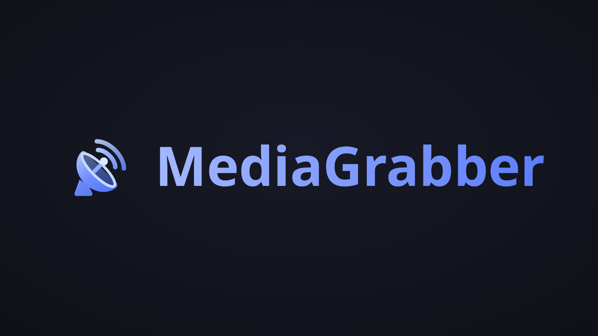

<div align="center">



# MediaGrabber (`v2.1`)

**Self-Hosted Media Ingestion, Download Queue Console, Metadata Editor & Jellyfin Companion Service**

Download, transcode, deduplicate, preview, and organize media from **YouTube**, **YouTube Music**, **Spotify**, **Instagram**, **TikTok**, and other `yt-dlp` / `gallery-dl` sources with real-time SSE log streaming, automated scheduled SHA-256 duplicate cleanup, custom per-site naming templates, bandwidth throttling (`--limit-rate`), YouTube RSS Auto-Grab, per-grab Subtitle/SponsorBlock controls, keyboard shortcuts, in-UI `cookies.txt` management, pre-flight dependency updates, scoped API keys, Navidrome radio sync, and native Jellyfin integration across **Linux**, **Windows 11**, and **Windows 10**.


</div>

---

## Dedicated Platform Guides

- **Windows 10 & Windows 11 (`mediagrabber.exe`, `grab.ps1`, Scheduled Task)**: See **[`WINDOWS.md`](./WINDOWS.md)**
- **Linux, Ubuntu App Store (Snap), `.deb` & Proxmox LXC**: See **[`LINUX.md`](./LINUX.md)**
- **Complete `v2.1` Feature Handoff**: See **[`HANDOFF.md`](./HANDOFF.md)**

---

## Quick Install

### Global npm CLI (Windows, Linux & macOS)

```bash
npm install -g mediagrabber
mediagrabber --open
```

### Ubuntu / Linux Server (`systemd` + `/usr/local/bin/grab`)

```bash
git clone -b mediagrabber https://github.com/ai-mayhemyt/mediagrabber.git /opt/mediagrabber && \
cd /opt/mediagrabber && \
sudo bash deploy/install-linux.sh --stable
```

- **Ubuntu App Store (Snap)**: Build/publish via [`snap/snapcraft.yaml`](./snap/snapcraft.yaml) (`snap install mediagrabber`).
- **Ubuntu/Debian `.deb`**: Build with `npm run build:deb` (`deploy/build-deb.sh`) and install with `sudo apt install ./dist-deb/mediagrabber_2.1.0_amd64.deb`.

### Windows 10 & Windows 11 (`.exe` or PowerShell Installer)

```powershell
git clone -b mediagrabber https://github.com/ai-mayhemyt/mediagrabber.git C:\MediaGrabber
cd C:\MediaGrabber
Set-ExecutionPolicy -Scope Process Bypass
.\deploy\install-windows.ps1 -Channel stable -RegisterStartupTask
```

Or download **`mediagrabber-win-x64.exe`** directly from [GitHub Releases](https://github.com/ai-mayhemyt/mediagrabber/releases) and launch `mediagrabber.exe --open`.

---

## Supported Platforms & Dependencies

| Platform / Environment | Support Status | Reported Version Tag | Notes |
| --- | --- | --- | --- |
| **Ubuntu 22.04 / 24.04 LTS & Snap** | Fully Supported | `v2.1-Linux` | `deploy/install-linux.sh`, `.deb`, & `snap/snapcraft.yaml` |
| **Debian 11 / 12 & Proxmox LXC** | Fully Supported | `v2.1-Linux` | Lightweight server / LXC container setup |
| **Windows 11 (`Build >= 22000`)** | Fully Supported | `v2.1-Windows11` | `mediagrabber.exe`, `grab.ps1`, `deploy/install-windows.ps1` |
| **Windows 10 (`Build < 22000`)** | Fully Supported | `v2.1-Windows10` | `mediagrabber.exe`, `grab.ps1`, `deploy/install-windows.ps1` |

**Core Runtime**: Node.js `20+` / `22 LTS` (not required for standalone binaries or Snap).  
**Mandatory Media Engines**: `yt-dlp`, `spotdl`, `gallery-dl`, `ffmpeg`, `jq` *(Linux)*, plus optional `deno` *(automatically installed by `install-windows.ps1`, `install-linux.sh`, `.deb`, and Snap)*.

---

## Keyboard Shortcuts

Press **`?`** anywhere in the Web UI to open the interactive Keyboard Shortcuts modal:
- **`/`** or **`Ctrl/Cmd + K`**: Focus Global Search
- **`N`**: Switch to Queue & focus URL batch input
- **`Ctrl/Cmd + Enter`** *(in URL input)*: Submit batch grab immediately
- **`1` / `2` / `3` / `4`**: Switch Queue / History / Utilities / Settings
- **`R`**: Refresh Queue, History & Storage
- **`Esc`**: Close active modal

---

## Companion Plugin: MediaGrabber — Jellyfin Edition

Queue YouTube, YouTube Music, Spotify, Instagram, and TikTok downloads directly inside Jellyfin (`10.8–10.11+`) using **[ai-mayhemyt/MediaGrabber-Jellyfin-Edition](https://github.com/ai-mayhemyt/MediaGrabber-Jellyfin-Edition)**:

```text
https://github.com/ai-mayhemyt/MediaGrabber-Jellyfin-Edition/releases/latest/download/manifest.json
```

---

## Standalone CLI Wrappers (`grab` / `grab.ps1`)

- **Linux**: `/usr/local/bin/grab "https://www.youtube.com/watch?v=..."`
- **Windows**: `powershell -NoProfile -ExecutionPolicy Bypass -File .\grab.ps1 "https://www.youtube.com/watch?v=..."`

Configure optional environment variables (`PORT`, `MEDIAGRABBER_DATA_DIR`, `MEDIAGRABBER_UPDATE_CHANNEL`) in `.env` based on `.env.example`.
