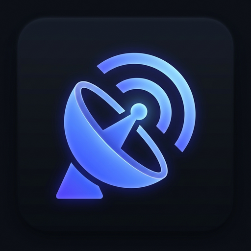

<div align="center">



# MediaGrabber — Jellyfin Edition

**Official Jellyfin Plugin for [MediaGrabber](https://github.com/ai-mayhemyt/mediagrabber)**

Queue YouTube, YouTube Music, Spotify, Instagram, and TikTok media downloads straight into your MediaGrabber libraries without leaving Jellyfin.


</div>

---

## Copy Jellyfin Plugin Repository URL

Copy this URL and add it in **Jellyfin → Dashboard → Plugins → Repositories → `+`**:

```text
https://github.com/ai-mayhemyt/MediaGrabber-Jellyfin-Edition/releases/latest/download/manifest.json
```

---

## What This Plugin Does

**MediaGrabber — Jellyfin Edition** connects your Jellyfin Dashboard directly to your running **MediaGrabber** server so you can add and manage downloads directly inside Jellyfin:

- **Single & Bulk Media Queueing**: Paste one URL or a multi-line playlist/batch of links from **YouTube**, **YouTube Music**, **Spotify**, **Instagram**, **TikTok**, and supported `yt-dlp` / `gallery-dl` sources.
- **Video & Audio Modes**: Pick **Video (MP4/MKV/WebM)** or **Audio Only (MP3/FLAC/M4A/Opus)** per download or set your preferred server default.
- **Inline API Key & Server Settings**: Configure and verify your MediaGrabber Server URL and required API key right inside **MediaGrabber Downloader** or **Dashboard → Plugins → MediaGrabber**.
- **Live Queue Monitor & Controls**: Watch active downloads progress in real time inside Jellyfin, cancel queued/running jobs, or retry failed items.
- **Required API Key Authentication**: Downloads, queue status, cancellations, and retries strictly require a valid `download`- or `admin`-scoped MediaGrabber API key generated in MediaGrabber (**Account → API Tokens**).
- **All-Version Jellyfin Support**: Automated CI builds dedicated `.zip` packages for **Jellyfin 10.8.x**, **10.9.x**, **10.10.x**, and **10.11+**.

---

## Supported Jellyfin Versions

| Jellyfin Series | Target Framework | Target ABI |
| --- | --- | --- |
| Jellyfin 10.11+ | `.NET 9.0` | `10.11.0.0` |
| Jellyfin 10.10.x | `.NET 8.0` | `10.10.0.0` |
| Jellyfin 10.9.x | `.NET 8.0` | `10.9.0.0` |
| Jellyfin 10.8.x | `.NET 6.0` | `10.8.0.0` |

---

## Step 1: Set Up the Original MediaGrabber Server (Prerequisite)

This plugin requires a running **[MediaGrabber](https://github.com/ai-mayhemyt/mediagrabber)** server (`v2.0-pre8` or newer, on **Linux**, **Windows 11**, or **Windows 10**):

1. **Install MediaGrabber**:
   - **Linux** (Ubuntu / Debian / Proxmox LXC):
     ```bash
     git clone -b mediagrabber https://github.com/ai-mayhemyt/mediagrabber.git /opt/mediagrabber && \
     cd /opt/mediagrabber && \
     sudo bash deploy/install-linux.sh
     ```
   - **Windows 10 / 11** (PowerShell):
     ```powershell
     git clone -b mediagrabber https://github.com/ai-mayhemyt/mediagrabber.git C:\MediaGrabber && cd C:\MediaGrabber && .\deploy\install-windows.ps1
     ```
   Choose **Nightly Pre-Releases** (`mediagrabber-nightly`) or **Full Releases** during installation. The service runs on port **`3000`** (`http://<your-server-ip>:3000`).
2. **Complete the First-Run Setup Wizard**:
   - Open `http://<your-server-ip>:3000` in your browser and follow the 5-step Setup Wizard to create your Admin account (without affecting existing accounts), set your media library folders (e.g., `/media/YouTube`, `/media/Music`), and optionally link Jellyfin library refresh.
3. **Generate a MediaGrabber API Key**:
   - Click your profile badge in the bottom-left sidebar → **API Tokens**.
   - Enter a name (for example `Jellyfin`), choose **`download`** (or **`admin`**) scope, and click **Create**.
   - Copy the generated `mg_...` API key (shown once upon creation).

---

## Step 2: Install & Connect the Jellyfin Plugin

1. In **Jellyfin**, open **Dashboard → Plugins → Repositories**.
2. Click **`+` (Add)** and enter:
   - **Repository Name:** `MediaGrabber - Jellyfin Edition`
   - **Repository URL:**
     ```text
     https://github.com/ai-mayhemyt/MediaGrabber-Jellyfin-Edition/releases/latest/download/manifest.json
     ```
3. Go to **Catalog → General → MediaGrabber**, select the version matching your Jellyfin server (`10.8`–`10.11+`), and click **Install**.
4. **Restart Jellyfin** to activate the plugin and load its logo card.
5. In Jellyfin, open **MediaGrabber Downloader** in the sidebar (or **Dashboard → Plugins → MediaGrabber**):
   - **MediaGrabber Server URL:** `http://127.0.0.1:3000` (or `http://<your-server-ip>:3000`)
   - **MediaGrabber API Key:** paste your `mg_...` key
6. Click **Test Connection & API Key**, then **Save API Key & Connect**.

---

## Manual Build from Source

Requires the matching .NET SDK (`6.0`, `8.0`, or `9.0`):

```bash
# Swap JellyfinSeries=10.8 | 10.9 | 10.10 | 10.11
dotnet publish MediaGrabber.Jellyfin/MediaGrabber.Jellyfin.csproj \
  -c Release \
  -p:JellyfinSeries=10.10 \
  -o ./dist/MediaGrabber
```

Copy `./dist/MediaGrabber/MediaGrabber.Jellyfin.dll` and `./logo.png` (renamed to `thumb.png`) into your Jellyfin plugins directory and restart Jellyfin.
